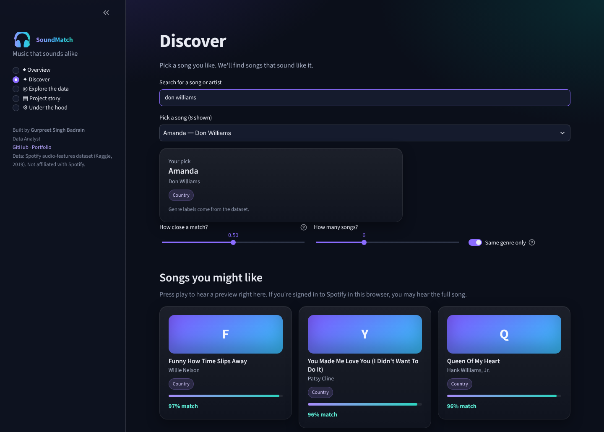
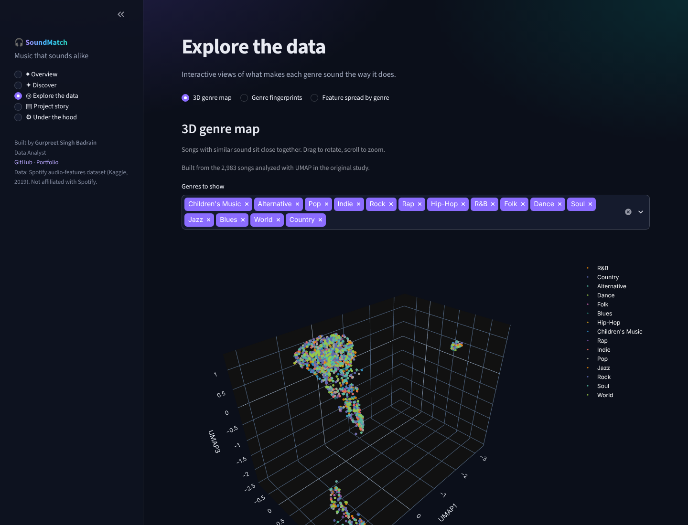
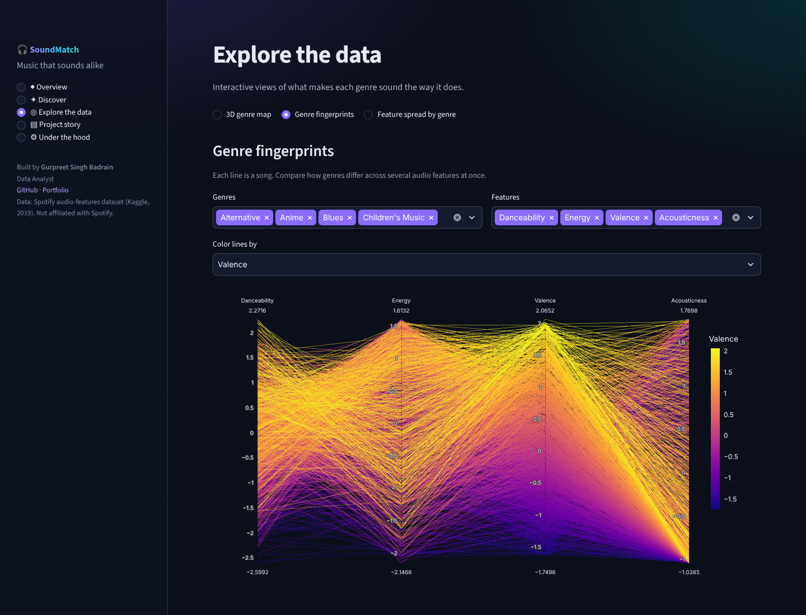
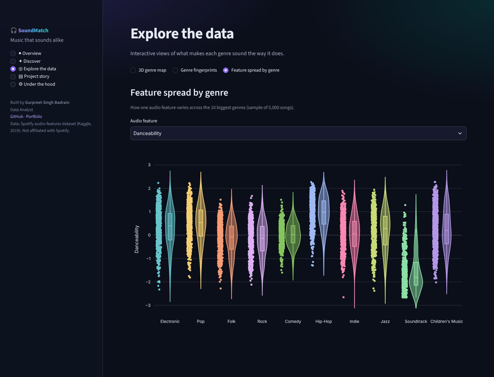

# SoundMatch — music that sounds alike

[](https://gbadrain-machine-learning.streamlit.app)


**SoundMatch** is an interactive music recommender. Pick a song you like and it finds songs that *sound* like it, by comparing more than 175,000 tracks on 12 audio features (energy, mood, tempo, danceability and more).

**[Try the live app →](https://gbadrain-machine-learning.streamlit.app)**


## Highlights

- **Listen while you browse.** Every recommended song has its own small Spotify player, so you can hear matches without leaving the page.
- **Explains itself.** A radar chart shows *why* songs match (their sound profiles line up), and a histogram shows how rare a close match really is.
- **Fast.** Search a song and get matches in under a second, with no external API calls.
- **Correct and tested.** Two app bugs and one data-leakage flaw in the original model found and fixed during the 2026 review, with 34 automated tests guarding the logic.
- **Honest about the data.** The app shows each song's dataset genre labels and notes their limits instead of hiding them.

### Skills demonstrated

| Area | What this project shows |
|---|---|
| Data cleaning | Handling missing values, duplicate listings, and inconsistent text across 232,000 rows |
| Feature engineering | Choosing which features belong in a similarity model (and removing ID-like columns that distort it) |
| Recommender systems | Cosine similarity on standardized features, top-N retrieval with a fast partial sort, genre filtering |
| Debugging | Tracing a production crash to a library upgrade, and a silent scoring bug to an index mismatch |
| Model validation | Spotting data leakage in an earlier model (90% accuracy that was really 36%) and re-running it correctly |
| Data visualization | 3D UMAP map, parallel coordinates, violin plots, radar and histogram charts with Plotly |
| Software practice | Automated tests (pytest), pinned dependencies, version control, deployment on Streamlit Community Cloud |

---

## What you can do

| Page | What it does |
|---|---|
| **Overview** | What the app does, key numbers, and how it works in three steps |
| **Discover** | Search a song, play it, and get matches as cards with a match %, genre labels and a built-in Spotify player on every song. Choose how close a match you want, how many songs, and whether to stay in the same genre |
| **Explore the data** | Interactive 3D genre map (UMAP), genre "fingerprints" (parallel coordinates), and how features spread across genres (violin plots) |
| **Project story** | The slides from the original analysis |
| **Under the hood** | The method in plain words, the full numbers behind every match, a radar chart of why songs match, and how rare a close match is |



*Example: Don Williams' "Amanda" returns Willie Nelson, Patsy Cline, Hank Williams Jr., Conway Twitty and George Strait — ranked by how closely their audio features match, with "Same genre only" turned on. (The Spotify players appear under each card in the live app.)*

## How the recommendations work

1. **Features.** Each song is described by 12 standardized audio features: acousticness, danceability, duration, energy, instrumentalness, liveness, loudness, mode, speechiness, tempo, time signature and valence.
2. **Similarity.** Every song becomes a 12-number vector. The match score is the **cosine similarity** between two songs' vectors (shown as a percentage).
3. **Clean results.** ID-like columns (encoded artist and genre numbers) are excluded from the math, the same song listed under several genres appears only once, and an optional **same-genre** filter keeps results within the song's genres.


Under the hood also explains each result visually: a **radar chart** compares your song's sound profile with its top 3 matches (here, Don Williams' "Amanda" next to Patsy Cline, Willie Nelson and Hank Williams Jr.), and a **histogram** shows how similar every song in the library is to your pick, so you can see how rare a close match is.


## Explore the data — interactive charts

**3D genre map.** Songs analyzed with UMAP, plotted in 3D. Songs that sound alike sit close together; drag to rotate.



**Genre fingerprints.** Parallel coordinates: each line is a song, so you can compare genres across several audio features at once.



**Feature spread by genre.** Violin plots showing how one feature (here, danceability) varies across the 10 biggest genres.



**Project story.** The slides from the original analysis, with simple previous/next navigation.


## 2026 upgrade — what changed and why

This started as a 2025 data-analytics bootcamp project. On **November 25, 2026** it was reviewed and rebuilt in one day to be more correct, faster, and easier to use. Here is the full list, in the order it happened.

### 1. Fixing what was broken
- **Crash on start-up.** The live app stopped with `'float' object has no attribute 'strip'`. Cause: the hosting service installed **pandas 3**, which treats blank cells differently, and one song in the data had no name. Fix: blank names are handled safely and that row is dropped.
- **Wrong similarity scores.** After the results were re-sorted, each song's score was read from the wrong row, so the scores shown (and the "how close a match" filter) didn't belong to the songs listed. Fix: each score is attached to its song before sorting. Checked on 300 random songs against a full, unshortened calculation: all matched.
- **Pinned versions.** Every package is now locked to an exact version that works on Python 3.13, so a surprise update can't break the app again.

### 2. Making the recommendations make sense
- **Cleaner features.** The similarity math had been using 24 columns, including label-encoded artist and genre numbers, UMAP coordinates and cluster labels. Those are IDs or derived values, not sound, and for about 98% of songs the UMAP/cluster values were filled-in averages. The model now uses **12 real audio features** only.
- **No duplicates.** The same song listed under several genres now appears once.
- **"Same genre only" switch.** Without it, results are pure "sounds alike" across genres. With it (the default), every result shares a genre with your song. Measured on 200 random songs: same-genre results went from 29% (off) to 100% (on).

### 3. Making it fast
- Removed a built-in **2-second pause** after every Spotify lookup.
- Replaced a **175,000-song dropdown** (which froze the browser) with a search box.
- Spotify links are now **built from each song's track ID**, so the app makes no API calls and needs no keys.
- A faster "top matches only" search (partial sort) and data caching. Search to results: about 0.6 seconds in testing.

### 4. Making it look and read like a product
- New name **SoundMatch**, dark theme, card layout, match % bars, genre badges and plain-language page names.
- A **Spotify player on every recommendation**, so you can listen without leaving the page.
- **Radar and histogram charts** on *Under the hood* that explain why songs match and how rare a close match is.
- Author section with photo, GitHub and portfolio links, and this README with screenshots.

### 5. Making it trustworthy
- **Re-checked the 2025 model results.** Found that the Random Forest's 90% accuracy came from data leakage (the genre was one of its inputs). Re-run correctly: 36% across 25 genres, versus 4% for guessing. See *Original analysis* below.
- **34 automated tests** (`pytest`) covering data cleaning, search, the recommendation logic, the same-genre filter, and the page building blocks.
- Every change was checked by running the real app on the real data before it went live.

### Tried and set aside: better genre labels from MusicBrainz
The dataset's genre labels are sometimes surprising (one "Country Road" is labeled Blues, Atlas Genius is labeled Children's Music). We tested replacing them with genres from **MusicBrainz**, a free, community-run music database:

- **Pilot on 100 artists:** 60% got genres, and they were more specific and often more accurate (John Mayall → blues rock, British blues; Atlas Genius → indietronica). Strict name matching correctly rejected wrong matches.
- **Why we stopped:** MusicBrainz allows about one request per second, so all 14,500 artists would have taken **up to about 30 hours** at the pace we measured; the genres are per *artist*, not per *song*; and the data is licensed for **non-commercial use only**.
- **Decision:** for a portfolio project the Kaggle labels are good enough, so the app keeps them and **shows each song's dataset genres openly** so users can judge them. It may be worth revisiting later.

## Data

- **Source:** Spotify audio-features dataset from Kaggle (about 232,000 rows, 2019). Many songs are listed under more than one genre, which is why there are about 175,000 unique songs.
- **Genre labels** come from the dataset and are sometimes surprising (one "Country Road" is labeled Blues). The app shows each song's dataset genres so this is visible to the user.
- This is a non-commercial portfolio project and is **not affiliated with Spotify**.

## Run it locally

```bash
git clone https://github.com/gbadrain/Music_Recommendation.git
cd Music_Recommendation
python3.13 -m venv .venv
source .venv/bin/activate
pip install -r requirements.txt
streamlit run dashboard.py
```

Run the tests:

```bash
pip install -r requirements-dev.txt
python -m pytest tests/ -v
```

No API keys are needed to run the app.

## Project structure

```
dashboard.py        Streamlit app: pages and layout
ui.py               Theme, cards and other HTML building blocks
data_utils.py       Data loading, cleaning, search and the recommendation engine
model_script.py     Original 2025 modeling script
spotify_model.ipynb Original 2025 analysis notebook (see note on its Random Forest result below)
tests/              Automated tests (pytest)
Resource/           SpotifyFeatures.csv (main dataset)
Output/             Results from the original analysis (UMAP, clusters, PCA)
Slides/             Slides shown on the Project story page
docs/screenshots/   Screenshots used in this README
.streamlit/         App theme
```

## Tech stack

Python · Streamlit · pandas · NumPy · scikit-learn · UMAP · Plotly · pytest

## Original analysis (2025) — the methods in plain language

The original notebook ([`spotify_model.ipynb`](spotify_model.ipynb)) and [backend analysis](backend_analysis.md) explored the data with four techniques. Here's what each one does, without the math.

> **Note on the notebook:** it is kept exactly as it was in 2025. Its Random Forest reports 90% accuracy, but that figure is inflated by data leakage. The corrected result is **36%** — see [Checking the 2025 results](#checking-the-2025-results-november-2026-review) below.

**Cosine similarity — "how alike are two songs?"**
Imagine describing every song with a list of numbers: how danceable, how energetic, how happy it sounds, and so on. Each list is like an arrow pointing in some direction. Two songs whose arrows point in nearly the same direction sound alike, even if one is louder overall. Cosine similarity measures the angle between the arrows: 1.0 means the same direction (very alike), 0 means unrelated, and negative means opposite. **This is the method the live app uses** for its recommendations.

**PCA and UMAP — "squeezing many features into a map"**
Twelve features are impossible to picture. PCA (Principal Component Analysis) and UMAP (Uniform Manifold Approximation and Projection) compress them into just a few numbers while keeping similar songs close together — like flattening a globe into a map. The notebook used PCA with 7 components and UMAP with 6 (measured with cosine distance). The **3D genre map** on the *Explore the data* page shows three of those UMAP dimensions.

**K-means clustering — "sorting songs into groups"**
K-means groups songs automatically by similarity: you choose how many groups (k), and it places each song in the group whose center it's closest to. The notebook tested several values of k to find a sensible number of groups. In 2026 we found the cluster labels covered only about 2% of songs, so they're no longer used in the recommendations.

**Random Forest — "can sound predict genre?"**
A Random Forest is a large set of decision trees ("Is energy above 0.7? Is acousticness below 0.2?…") that each make a guess and then vote. The notebook trained one (150 trees, balanced across genres, 80/20 train/test split) to predict a song's genre from its audio features — a useful check of how much "sound" really tells you about "genre".

### Checking the 2025 results (November 2026 review)

During the 2026 review the original results were checked against the notebook, and two problems were found and corrected:

1. **A results table in the old README couldn't be traced to the notebook.** Its figures (72–76% accuracy) don't appear anywhere in the notebook's outputs, so it has been removed.
2. **The Random Forest's 90% accuracy came from data leakage.** One of the model's inputs was `genre_encoded` — the genre itself, the very thing it was predicting — and it was the model's most important feature (39%). That's like grading a test with the answers printed on the question sheet.

The model was re-run correctly, using only the 12 audio features:

| Random Forest predicting genre | Accuracy |
|---|---|
| **Audio features only (corrected, 2026)** | **36%** |
| Random guessing (25 genres) | 4% |
| Same model with the genre leaked in (the 2025 setup) | 94% — not meaningful |

*Setup: 20,000 songs (up to 800 per genre, songs listed under only one genre), 25 genres, 80/20 split, fixed random seed. One run, so treat ±2 points as noise.*

**What it means:** sound alone predicts genre about **9 times better than guessing**, but far from perfectly. Comedy, opera, soundtrack and classical are easy to tell apart (they *sound* distinctive), while indie, alternative, rock and soul overlap heavily. The most useful features were speechiness, acousticness, danceability and instrumentalness. This is also why SoundMatch offers a **"Same genre only"** switch: similar sound doesn't always mean the same genre.

**Clustering check:** the notebook's k-means silhouette scores were low (best 0.29 at 2 clusters, falling to about 0.14 at 9), meaning songs don't split into clean, separate groups. That supports the 2026 decision to drop cluster labels from the recommendations.

## About the author

**Gurpreet Singh Badrain** — Data Analyst

- Portfolio: [datascienceportfol.io/gbadrain](https://www.datascienceportfol.io/gbadrain)
- GitHub: [gbadrain](https://github.com/gbadrain)
- LinkedIn: [gurpreet-badrain](http://linkedin.com/in/gurpreet-badrain-b258a0219)
- Email: gbadrain@gmail.com

Built in 2025 with help from GitHub Copilot; upgraded in 2026 with help from Claude.

---

*"Without data, you're just another person with an opinion. But with hard work and the right analysis, data becomes the key to unlocking insights that drive real impact."*
