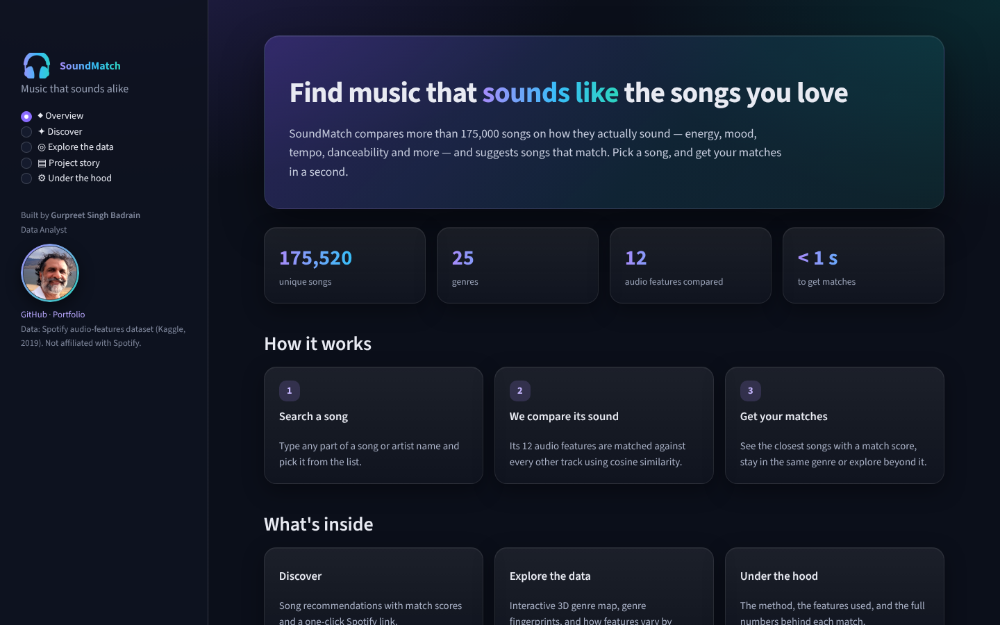
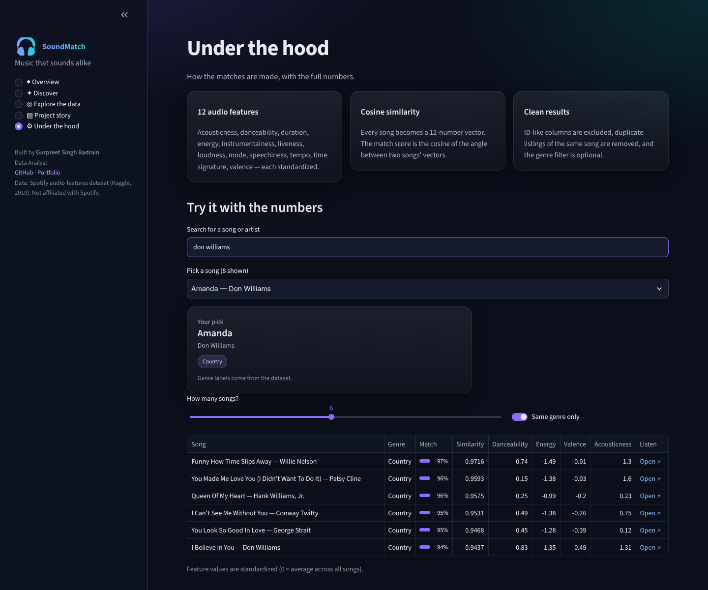
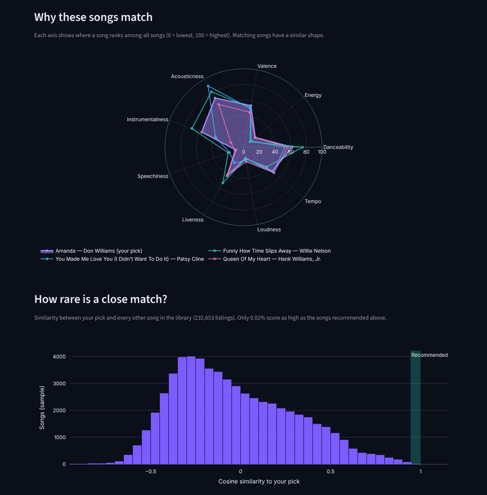
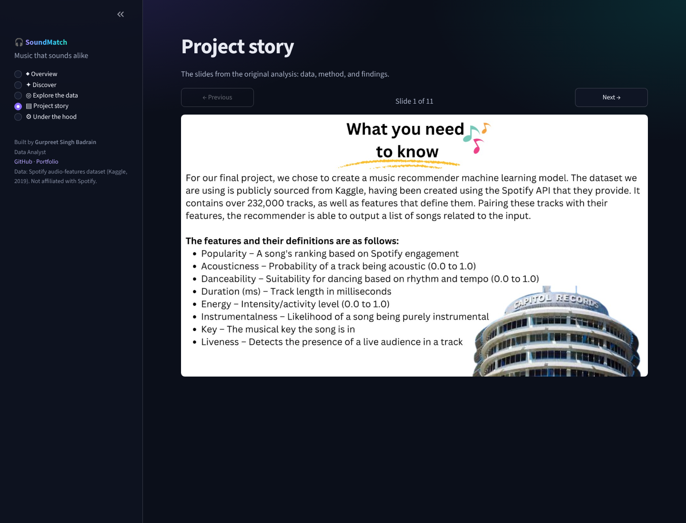

# SoundMatch — music that sounds alike

[](https://gbadrain-machine-learning.streamlit.app)


**SoundMatch** is an interactive music recommender. Pick a song you like and it finds songs that *sound* like it, by comparing more than 175,000 tracks on 12 audio features (energy, mood, tempo, danceability and more).

**[Try the live app →](https://gbadrain-machine-learning.streamlit.app)**



## Highlights

- **Listen while you browse.** Every recommended song has its own small Spotify player, so you can hear matches without leaving the page.
- **Explains itself.** A radar chart shows *why* songs match (their sound profiles line up), and a histogram shows how rare a close match really is.
- **Fast.** Search a song and get matches in under a second, with no external API calls.
- **Correct and tested.** Two real bugs found and fixed during the 2026 upgrade, with 33 automated tests guarding the logic.
- **Honest about the data.** The app shows each song's dataset genre labels and notes their limits instead of hiding them.

### Skills demonstrated

| Area | What this project shows |
|---|---|
| Data cleaning | Handling missing values, duplicate listings, and inconsistent text across 232,000 rows |
| Feature engineering | Choosing which features belong in a similarity model (and removing ID-like columns that distort it) |
| Recommender systems | Cosine similarity on standardized features, top-N retrieval with a fast partial sort, genre filtering |
| Debugging | Tracing a production crash to a library upgrade, and a silent scoring bug to an index mismatch |
| Data visualization | 3D UMAP map, parallel coordinates, violin plots, radar and histogram charts with Plotly |
| Software practice | Automated tests (pytest), pinned dependencies, version control, deployment on Streamlit Community Cloud |

---

## What you can do

| Page | What it does |
|---|---|
| **Overview** | What the app does, key numbers, and how it works in three steps |
| **Discover** | Search a song, play it, and get matches as cards with a match %, genre labels and a built-in Spotify player on every song. Choose how close a match you want, how many songs, and whether to stay in the same genre |
| **Explore the data** | Interactive 3D genre map (UMAP), genre "fingerprints" (parallel coordinates), and how features spread across genres (violin plots) |
| **Project story** | The slides from the original analysis |
| **Under the hood** | The method in plain words, the full numbers behind every match, a radar chart of why songs match, and how rare a close match is |


*Example: Don Williams' "Amanda" returns Willie Nelson, Patsy Cline, Hank Williams Jr., Conway Twitty and George Strait — ranked by how closely their audio features match, with "Same genre only" turned on. (The Spotify players appear under each card in the live app.)*

## How the recommendations work

1. **Features.** Each song is described by 12 standardized audio features: acousticness, danceability, duration, energy, instrumentalness, liveness, loudness, mode, speechiness, tempo, time signature and valence.
2. **Similarity.** Every song becomes a 12-number vector. The match score is the **cosine similarity** between two songs' vectors (shown as a percentage).
3. **Clean results.** ID-like columns (encoded artist and genre numbers) are excluded from the math, the same song listed under several genres appears only once, and an optional **same-genre** filter keeps results within the song's genres.



Under the hood also explains each result visually: a **radar chart** compares your song's sound profile with its top 3 matches (here, Don Williams' "Amanda" next to Patsy Cline, Willie Nelson and Hank Williams Jr.), and a **histogram** shows how similar every song in the library is to your pick, so you can see how rare a close match is.



## Explore the data — interactive charts

**3D genre map.** Songs analyzed with UMAP, plotted in 3D. Songs that sound alike sit close together; drag to rotate.


**Genre fingerprints.** Parallel coordinates: each line is a song, so you can compare genres across several audio features at once.


**Feature spread by genre.** Violin plots showing how one feature (here, danceability) varies across the 10 biggest genres.


**Project story.** The slides from the original analysis, with simple previous/next navigation.



## 2026 upgrade — what changed and why

This started as a 2025 data-analytics bootcamp project. In November 2026 it was rebuilt to be faster, more correct and easier to use:

- **Fixed a crash** caused by pandas 3 and one blank song name in the data.
- **Fixed a scoring bug**: similarity scores were being read from the wrong rows, so the displayed scores (and the score filter) didn't match the songs shown.
- **Cleaner feature set**: removed label-encoded IDs, UMAP and cluster columns from the similarity math, which had been mixing "made-up" numbers into "sounds alike".
- **Much faster**: removed a built-in 2-second pause per Spotify lookup, replaced the 175,000-item dropdown with a search box, and now builds Spotify links directly from track IDs (no API calls). Search to results took about 0.6 seconds in testing.
- **New design**: dark theme, card layout, match % bars, renamed pages and plain-language wording.
- **Built-in listening and explanations**: a Spotify player on every recommendation, plus radar and histogram charts that explain each result.
- **Tests and pinned versions**: 33 automated tests (`pytest`) and exact package versions, so a surprise library update can't break the app again.

## Data

- **Source:** Spotify audio-features dataset from Kaggle (about 232,000 rows, 2019). Many songs are listed under more than one genre, which is why there are about 175,000 unique songs.
- **Genre labels** come from the dataset and are sometimes surprising (one "Country Road" is labeled Blues). The app shows each song's dataset genres so this is visible to the user.
- This is a non-commercial portfolio project and is **not affiliated with Spotify**.

## Run it locally

```bash
git clone https://github.com/gbadrain/Music_Recommendation.git
cd Music_Recommendation
python3.13 -m venv .venv
source .venv/bin/activate
pip install -r requirements.txt
streamlit run dashboard.py
```

Run the tests:

```bash
pip install -r requirements-dev.txt
python -m pytest tests/ -v
```

No API keys are needed to run the app.

## Project structure

```
dashboard.py        Streamlit app: pages and layout
ui.py               Theme, cards and other HTML building blocks
data_utils.py       Data loading, cleaning, search and the recommendation engine
model_script.py     Original 2025 modeling script
spotify_model.ipynb Original 2025 analysis notebook
tests/              Automated tests (pytest)
Resource/           SpotifyFeatures.csv (main dataset)
Output/             Results from the original analysis (UMAP, clusters, PCA)
Slides/             Slides shown on the Project story page
docs/screenshots/   Screenshots used in this README
.streamlit/         App theme
```

## Tech stack

Python · Streamlit · pandas · NumPy · scikit-learn · UMAP · Plotly · pytest

## Original analysis (2025)

The original notebook ([`spotify_model.ipynb`](spotify_model.ipynb)) and [backend analysis](backend_analysis.md) cover data exploration, UMAP clustering and model comparisons. The metrics below are reported from that notebook and were **not re-verified** in the 2026 rebuild:

| Approach | Accuracy | Precision | Recall |
|---|---|---|---|
| Cosine similarity | ~72% | ~70% | ~85% |
| UMAP clustering | ~75.6% | ~72% | ~88% |
| Random Forest + UMAP | ~75.8% | ~71.6% | ~90.5% |

## About the author

**Gurpreet Singh Badrain** — Data Analyst

- Portfolio: [datascienceportfol.io/gbadrain](https://www.datascienceportfol.io/gbadrain)
- GitHub: [gbadrain](https://github.com/gbadrain)
- LinkedIn: [gurpreet-badrain](http://linkedin.com/in/gurpreet-badrain-b258a0219)
- Email: gbadrain@gmail.com

Built in 2025 with help from GitHub Copilot; upgraded in 2026 with help from Claude.

---

*"Without data, you're just another person with an opinion. But with hard work and the right analysis, data becomes the key to unlocking insights that drive real impact."*
